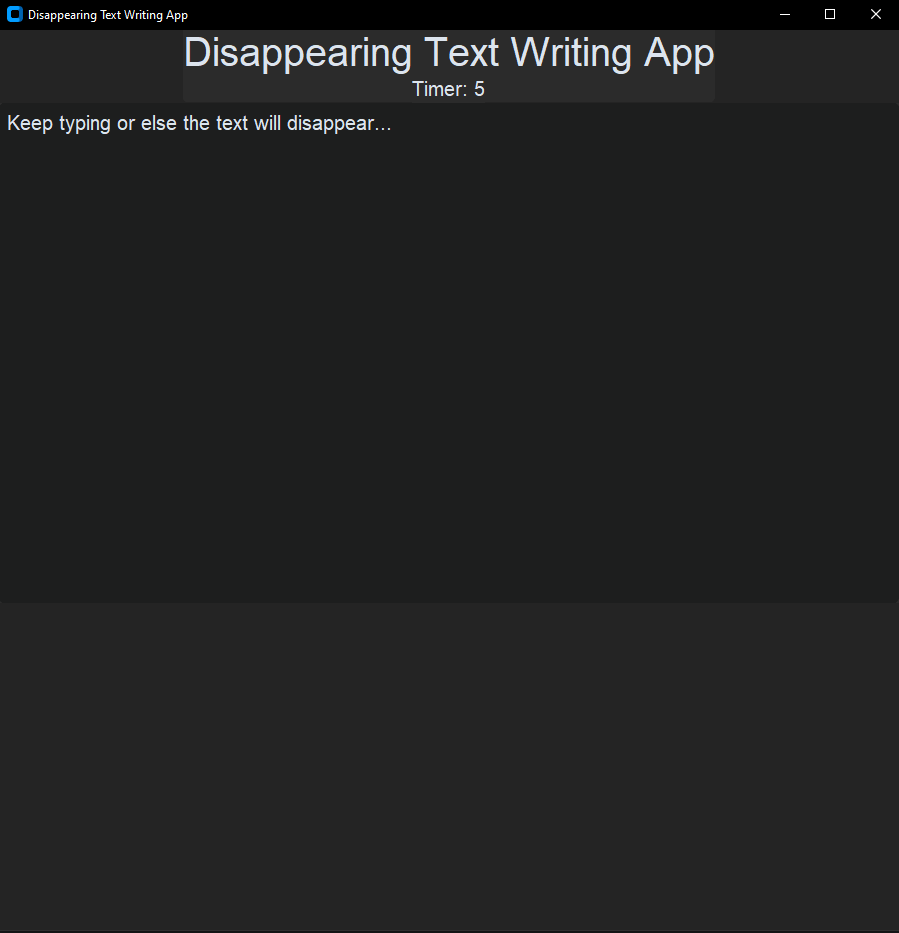
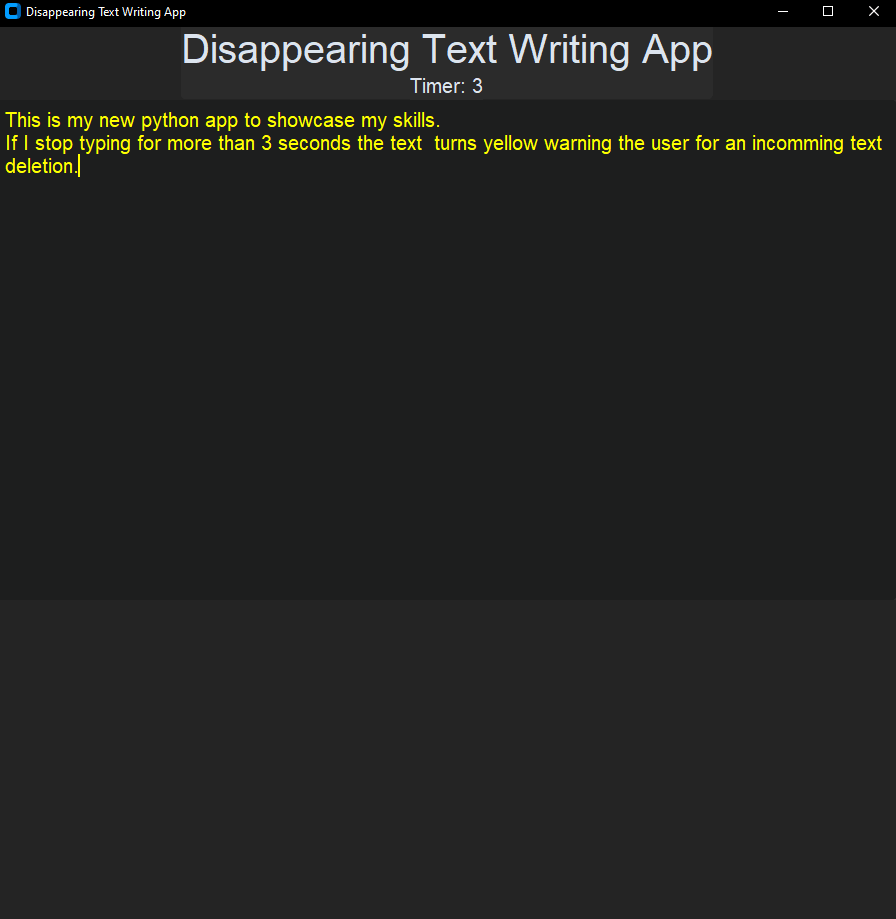
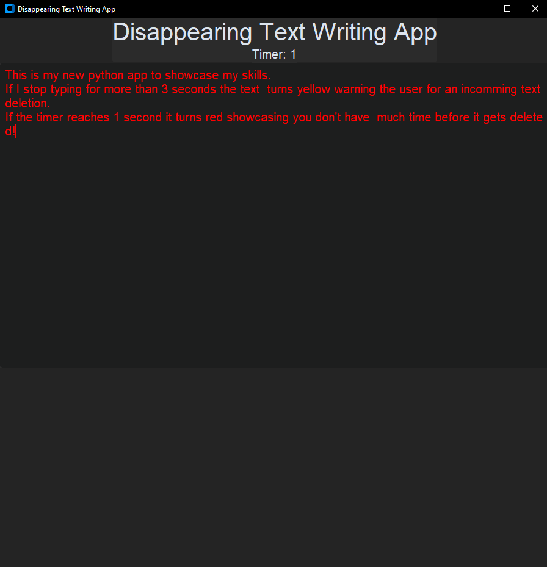
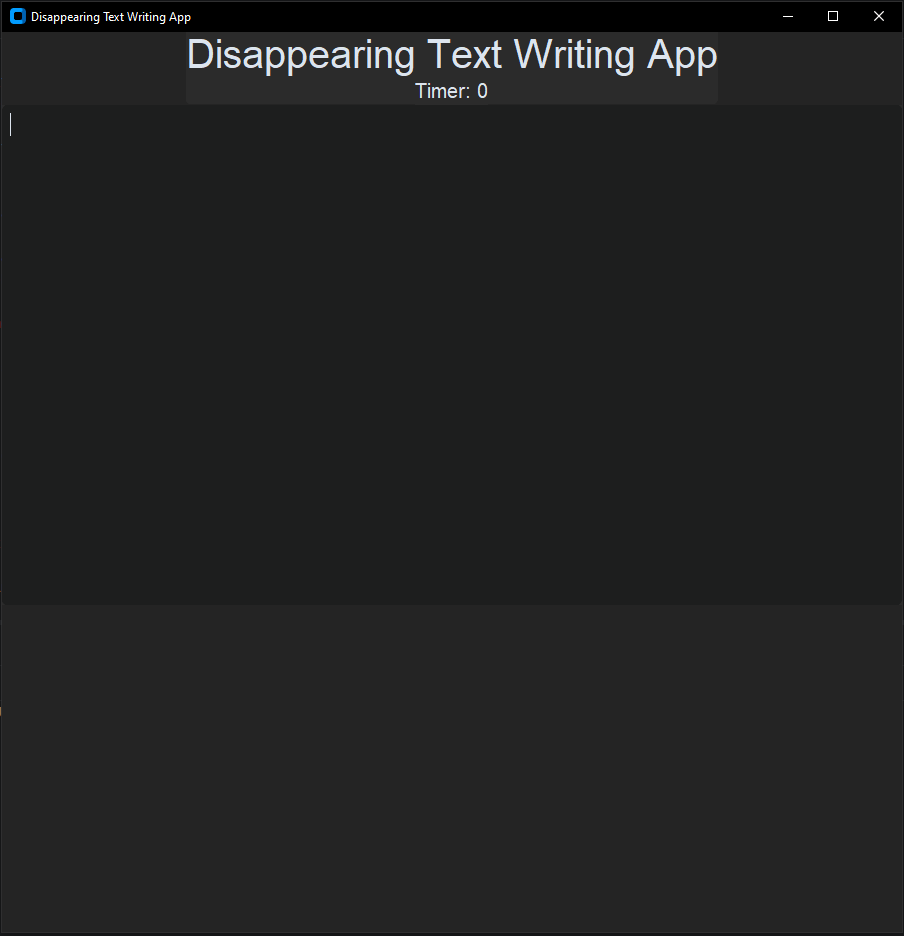

⌨️ Disappearing Text Writing App

A fun writing challenge built with Python and CustomTkinter. Keep typing to keep your text alive! If you stop typing for too long, your text disappears.

## 📸 Screenshots

### 1. App Start

### 2. Yellow Warning

### 3. Red Warning

### 4. Timer Reaches Zero

✨ Features
⏱️ Countdown timer that resets when you type.
🎨 Dynamic text colors: white, yellow, and red.
💨 Automatically deletes your text when you stop typing.
🖥️ Simple graphical interface built with CustomTkinter.
